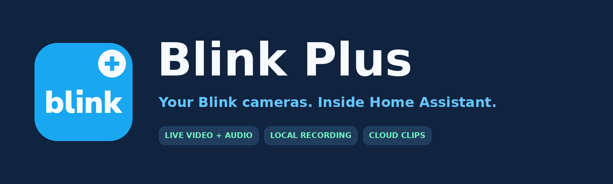

<p align="center"></p>

# Blink Plus

Native Blink live video and audio, two-way talk for compatible clients, local recording, cloud clip browsing, and camera controls in one Home Assistant custom integration. Setup and options are configured in the UI.

[Installation](#installation) | [Options](docs/CONFIGURATION.md) | [Two-way talk](docs/TWO_WAY_TALK.md) | [How it works](docs/ARCHITECTURE.md) | [Test results](docs/VALIDATION.md) | [Changelog](CHANGELOG.md)

**Current release: v0.2.0.** Requires Home Assistant 2026.11.0 or newer and a Blink account. This independent project uses unofficial Blink cloud APIs and is not affiliated with Amazon or Blink.

Live view and cloud browsing are enabled by default. A camera starts streaming when a player connects. Snapshot, recording, motion, arming, and enabled pan/tilt controls can operate your cameras; setup does not automatically arm the system or start recordings. Battery cameras still need to wake and contact Blink's cloud.

## Included features

- Native H.264 video with AAC audio through Home Assistant's stream integration.
- One shared upstream live session per camera, bounded sessions, reconnect cooldown, and cleanup on unload.
- A direct native MPEG-TS stream per camera for low-delay players and tools (`/api/blink_plus/live/<camera entity id>`, authenticated).
- Two-way talk: an authenticated endpoint that speaks a stream of AAC audio through an open live session (`/api/blink_plus/talk/<camera entity id>`).
- Cached camera images plus a button to request a fresh snapshot.
- A **Record local clip** button that saves MP4 video and audio to Home Assistant media storage.
- **Blink cloud clips** in the Media browser, grouped by account and camera, with thumbnails and seekable playback.
- Camera motion detection switches and network arming switches.
- Motion, low battery, and connectivity binary sensors where reported.
- Temperature, calibrated temperature, battery voltage or bars, Wi-Fi signal, Sync Module signal, and last-recording sensors where supported. Unsupported data is omitted; temperature follows HA's unit settings.
- Optional left/right/up/down/home buttons for cameras with a compatible pan/tilt mount.
- UI login, verification-code entry, reauthentication, configuration, and redacted diagnostics.

## New in 0.2.0

Two-way talk can now send your voice to a camera through its active live connection. This release preserves Blink's per-session media token, sends the initial keepalive, and waits for the speaker acknowledgement before audio starts.

A compatible client provides microphone capture and its Talk button. The integration provides the authenticated AAC upload API. A custom browser dashboard was used to verify real voice on a Mini-class camera. The [talk guide](docs/TWO_WAY_TALK.md) explains client requirements, update steps, a working ffmpeg/curl example, request limits and troubleshooting.

## Installation

### HACS / Marketplace custom repository

This repository can be installed as a custom integration repository. A passing HACS check does not mean it has been accepted into the default catalog.

1. Open HACS (called **Marketplace** on newer installations).
2. Open its menu, choose **Custom repositories**, and add `https://github.com/zperkd/blink-plus` with category **Integration**.
3. Find **Blink Plus**, download it, and restart Home Assistant.
4. Open **Settings > Devices & services > Add integration** and search for **Blink Plus**.
5. Enter your Blink account email and password, then the verification code if requested.
6. Open the integration's **Configure** menu to adjust polling, streaming, recording, cloud browsing, and optional pan/tilt settings.

HACS must already be installed. UI wording can vary by version. See [HACS custom repository instructions](https://www.hacs.xyz/docs/faq/custom_repositories/).

### Manual installation

Download the release's `blink-plus-v0.2.0.zip`. Extract its `custom_components/blink_plus` folder into your HA configuration directory, producing `/config/custom_components/blink_plus/manifest.json`. Restart HA, then follow steps 4-6 above. Do not place the enclosing repository folder inside `custom_components`.

### Moving from the built-in Blink integration

Blink Plus uses its own `blink_plus` domain and creates new entities. Existing dashboards and automations must be updated to those entities. Its network control is an **Armed switch**, not an alarm-control-panel entity. Disable the original Blink integration after checking the replacement to avoid duplicate polling and controls. No automatic migration is performed.

## Updating from 0.1.x

Download 0.2.0 in HACS / Marketplace and restart Home Assistant. Existing Blink Plus entities and settings are retained. Live viewing, snapshots, recordings, cloud clips, motion/arming and pan/tilt remain available. Talk uses the existing camera entity and an open live session. See the [upgrade and talk prerequisites](docs/TWO_WAY_TALK.md#update-and-prerequisites).

## Everyday use

Open a camera entity or add a camera card to view live video. Use **Take snapshot** for a fresh still; viewing the cached image does not itself request a new snapshot.

Press **Record local clip** to save an MP4. By default, files go into the first configured HA media directory under `blink_plus`. Local recordings persist and have no automatic retention policy. The camera's `last_local_recording` attribute identifies the most recent saved file.

Open **Media > Blink cloud clips**, choose your account, then a camera. This lists existing cloud clips available to your Blink account; it does not add cloud recording entitlement or browse Sync Module USB storage. Local recording and Blink cloud storage are separate features.

Enable pan/tilt only for cameras with a compatible mount in **Configure**. Adjust step size and axis inversion there. Details and automation examples are in [Configuration](docs/CONFIGURATION.md).

## Performance and tested support

Seven cameras, including Mini, battery-camera, and doorbell classes, passed real HA browser playback tests. Final 20-second samples displayed approximately 15-30 fps at native resolution with decoded audio and no buffering events. Browser startup took **10.19-14.09 seconds**. This remains cloud-dependent live view; startup is not instantaneous.

Local MP4 recording was tested on all three camera classes. Cloud browsing listed 1,000 clips across seven camera folders and verified authenticated, seekable playback. Snapshot, motion/arming, and mount controls were exercised and original settings restored.

The automated suite contains **83 tests**, plus five opt-in live-test groups. See [Validation](docs/VALIDATION.md) for measurements and limits. Fresh login/MFA has automated coverage; live tests reused an existing session. Other models, phone playback, casting, and long-term reliability remain unverified.

Two-way talk was verified with a Mini-class camera using real voice and tones, including with the Blink app closed. Other camera models need independent speaker testing. A compatible microphone client is required. See [Two-way talk](docs/TWO_WAY_TALK.md).

## Current limits

Motion is polled rather than pushed. Night vision, sensitivity, activity zones, remote clip settings, and Sync Module USB clips are not implemented. Camera-reported data varies by model and account. Blink cloud availability, subscription entitlements, and camera settings still apply.

Live sessions are time-limited to protect resources and batteries. Leaving a live card open can cause later reconnects; configure session duration and cooldown deliberately. Home Assistant's per-camera **Preload stream** setting is ignored for Blink Plus cameras, because it would keep waking them with nobody watching. For continuous surveillance, these cloud battery cameras have practical limits.

## Troubleshooting and support

- Slow startup: compare with the Blink app, check Wi-Fi and battery condition, and consult the measured startup range above.
- Missing sensors: wait for the next refresh; only actual reported values create sensors.
- Missing clips: check account entitlement, history window, clip limit, and cloud browsing options.
- Recording fails: ensure the selected directory is allowed by HA and recording duration plus 10 seconds fits within the live-session limit.
- Talk is silent or unavailable: wait for live video, check the AAC format and camera control permission, and use the [talk troubleshooting table](docs/TWO_WAY_TALK.md#http-interface).
- Expired session: complete HA's reauthentication flow.

Download diagnostics from the integration menu and [open an issue](https://github.com/zperkd/blink-plus/issues). Include HA/Blink Plus versions, camera model, symptoms, and steps to reproduce. Review attachments before posting; never include passwords, verification codes, tokens, private clips, or unredacted account exports.

<details>
<summary>Temporary debug logging</summary>

Enable this only while reproducing an issue, then disable it:

```yaml
logger:
  logs:
    custom_components.blink_plus: debug
```

Review logs for private information before sharing. Avoid enabling verbose authentication-library logging in a public report.
</details>

## Development and license

Official HACS and hassfest validation and automated tests run in [GitHub Actions](https://github.com/zperkd/blink-plus/actions). See [Contributing](CONTRIBUTING.md) for test setup and release checks. Original project artwork is included locally for Home Assistant branding. Licensed under [MIT](LICENSE).
