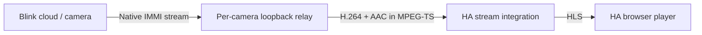

# How Blink Plus works

Blink Plus is a single Home Assistant config-entry integration using `blinkpy==0.25.9`. HA owns credentials, polling, entities, stream players, and media browsing. No separate relay service, Android app, external container, or exposed network port is required.

## Setup and lifecycle

The config flow signs in through Blink, requests MFA when necessary, and stores the resulting authentication session in HA's config entry. Passwords and verification codes are not retained by this integration. Reauthentication preserves the registered hardware ID. Session data remains sensitive and is protected by HA's storage and backup security.

The coordinator polls cloud state, serializes control operations, and refreshes state following commands. Sensors are created only for available data, including capabilities reported later. Diagnostics use an allowlist and omit account identifiers, camera names, credentials, and media URLs.

Unload and HA shutdown close relays and cancel owned timers/downloads. Options updates reload the entry. Local MP4 recordings persist; temporary cloud caches do not.

## Live video path

Each camera receives an ephemeral TCP listener bound to loopback. The upstream live session starts when a player connects, rather than when HA loads. Viewers of that camera share its upstream. Different cameras have independent relays. Blink's framing is decoded into MPEG-TS without converting every frame to a JPEG.

The relay scopes a compatibility fix to each connection, validates payload lengths, bounds client writes, and cleans up disconnects. Session duration and reconnect cooldown constrain repeated cloud/camera use. Native video preserves the camera's actual resolution and frame rate; HA stream probing and HLS buffering still contribute to startup time.

The native transport inherits blinkpy 0.25.9's IMMI TLS behavior, including its disabled certificate verification on that live connection. REST requests use HA's aiohttp session. This implementation does not claim end-to-end verified TLS for the native live transport.

## Local MP4 recording

The recording button uses HA's camera/stream recording path. It requests a bounded native live session and writes an H.264/AAC MP4 into an allowed HA directory. Duration is checked against the live-session limit. Successful saves update the camera attribute and emit a completion event. This feature does not submit a Blink cloud-record command or modify cloud retention.

## Cloud clips

The media-source provider fetches paginated Blink cloud metadata and groups valid clips by account and camera. History, clip count, and refresh settings bound the catalogue. Deleted or malformed entries are excluded.

A player receives a short-lived signed HA URL, not a Blink token or raw cloud URL. The HTTP view accepts authenticated HA requests or valid HA-signed URLs. It validates entry, media kind, clip identity, and the exact HTTPS Blink origin before fetching media.

Blink's origin ignored Range requests in testing. The integration therefore downloads a clip into a private temporary cache, then lets HA serve byte ranges for seeking. Per-clip locks deduplicate concurrent downloads, a semaphore bounds transfers, and per-file/total size limits bound storage. Failed partial files are removed; eviction and unload clean up cached media. Signed URLs expire after 10 minutes, so treat them as temporary access grants.

## Controls and limitations

Snapshots request a new camera image and wait for updated thumbnail metadata. Ordinary camera stills use the cached image. Motion and arming use Blink control APIs followed by a state refresh. Optional mount commands travel over the native live connection.

This integration does not implement push events, two-way talk, USB clip retrieval, or every setting in the Blink app. Model-specific capabilities and cloud API behavior can change independently of this project. See [validation evidence](VALIDATION.md) for what was actually tested.
